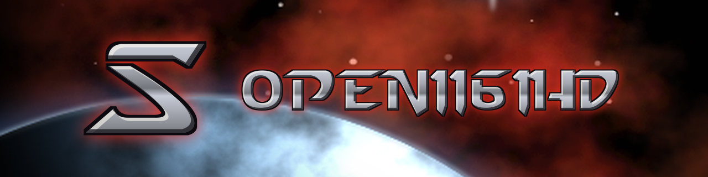
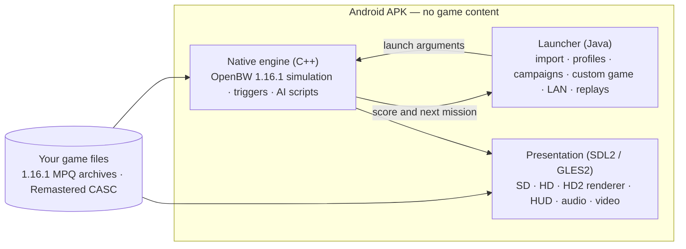

<p align="center">
  
</p>

<p align="center">
  <b>StarCraft: Brood War on Android phones and tablets: the classic 1.16.1 game and its Remastered HD look in one
  app, played from your own copy of the game.</b>
</p>

<p align="center">
  
  
  
  
  
  
</p>

> [!IMPORTANT]
> **This project contains no game content.** The APK holds the engine and the launcher only.
> Units, maps, campaigns, sounds, music, portraits, cinematics and texts are read at run time from **your own,
> legally owned copy of StarCraft: Brood War 1.16.1** (and, for the HD look, of StarCraft: Remastered), which you
> import from the launcher on first start. No game data is distributed here and none may be requested here.
>
> This project is not affiliated with or endorsed by Blizzard Entertainment.

## Contents

- [What it is](#what-it-is)
- [Feature status](#feature-status)
- [Requirements](#requirements)
- [Installing and game files](#installing-and-game-files)
- [How it fits together](#how-it-fits-together)
- [Building](#building)
- [Tests](#tests)
- [Project layout](#project-layout)
- [Status and roadmap](#status-and-roadmap)
- [Credits](#credits)
- [Licence and legal notice](#licence-and-legal-notice)

<a id="what-it-is"></a>


open1161HD is an Android port of [OpenBW](https://github.com/OpenBW/openbw), the open reimplementation of the
StarCraft: Brood War 1.16.1 game engine. It has three parts:

- **The simulation core** — OpenBW's 1.16.1 rules, kept deterministic: LAN games stay in lockstep and replays play
  back frame for frame. This port completes the trigger engine, the campaign AI scripts, saving and loading, and
  reading Remastered (`seRS`) replays.
- **The presentation** — an SDL2 renderer with three graphics tiers. **SD** draws the classic sprites from the 1.16.1
  archives; **HD** and **HD2** draw the Remastered sprites, terrain, portraits and cinematics straight from a
  Remastered install (CASC), with this project's own CASC reader and VP8/VP9/WebM decoders. A touch HUD built for
  tablets, keyboard and mouse support and an optional GPU post-processing chain sit on top.
- **The launcher** — the Android front end: data import, player profiles, the six campaigns with briefings and score
  screens, Custom Game against the built-in AI, LAN lobby, replays, mods and settings.

The aim is to play Brood War on a tablet or phone exactly as the 1.16.1 rules play it, in the classic look or the
Remastered one.

<a id="feature-status"></a>


Legend: **Working** — used in the regular test runs or played on real devices ·
**In progress** — partly built, not finished or not fully verified · **Planned** — decided, not built ·
**Not planned** — will not be implemented.

| Area | Feature | Status | Notes |
|---|---|---|---|
| Game data | Import of the 1.16.1 archives from the launcher | Working | `StarDat.mpq`, `BrooDat.mpq`, `patch_rt.mpq`; CD archives for campaigns and music |
| Game data | Remastered install (CASC) for the HD tiers | Working | Read in place; no conversion step |
| Launcher | Profiles, Options, Help, mods, in-app updates | Working | Lithuanian and English |
| Launcher | Campaigns with briefings, progress and a score screen | Working | All six episodes; mission end window, Continue / Restart / Mission list |
| Launcher | Custom Game against the computer | Working | One built-in AI with four difficulty levels |
| Game | Full 1.16.1 simulation, triggers, campaign AI scripts | Working | Determinism gates on every change to the core |
| Game | Save and load | Working | In game and from the launcher |
| Game | Use Map Settings (UMS) maps | In progress | Slot setup, preplaced unit properties and trigger edge cases |
| Game | EUD maps | Planned | A measured subset first (deaths, resources, unit counts) |
| Graphics | SD, HD and HD2 tiers | Working | HD sprites, terrain, portraits, cinematics |
| Graphics | Remastered effects in HD2/HD | In progress | Drawn from SD art today |
| Graphics | GPU post-processing: sharpen, bloom, colour grade, shadows | Working | All optional, off by default |
| Controls | Touch HUD, S Pen, pinch zoom | Working | Designed on a Galaxy Tab S8 Ultra |
| Controls | Keyboard and mouse | Working | Classic hotkeys |
| Replays | Classic `.rep` and Remastered replays, timeline, speed | Working | Recording of own games included |
| Multiplayer | LAN (FFA and teams), optional house rules | Working | Up to 8 players |
| Multiplayer | Online multiplayer | Not planned | |

<a id="requirements"></a>


**To play**

- An Android phone or tablet with Android 7.0 (API 24) or later, `arm64-v8a` (or `x86_64` for the emulator).
  Development devices are a Samsung Galaxy Tab S8 Ultra, a Galaxy Tab S7+ and a Galaxy S20+.
- Your own copy of **StarCraft: Brood War 1.16.1**: its data archives, and the CD archives for campaigns and music.
- Optional, for the HD tiers: an installed **StarCraft: Remastered** (its `Data` folder and `.build.info`).

**To build**

- Android SDK with platform 34, NDK 26.3.11579264, CMake 3.22.1.
- JDK 21 (Android Studio's JBR) and Gradle 8.9.

<a id="installing-and-game-files"></a>


1. Install an APK from the [Releases](../../releases) page, or build one (see [Building](#building)).
   Installed copies update themselves from the Releases page when you allow it.
2. Copy the game files to the device:

   | Edition | You provide |
   |---|---|
   | Classic (SD) | the 1.16.1 archives (`StarDat.mpq`, `BrooDat.mpq`, `patch_rt.mpq`; `StarCraft.mpq` and `BroodWar.mpq` from the CDs for campaigns and music) |
   | HD | additionally, a Remastered install: the folder that holds `Data` and `.build.info` |

3. On first start, choose the folder that holds the archives (or pick the files one by one) in the launcher's import
   screen. The archives are copied into the app's own storage; a Remastered folder is read where it is and needs the **All files access** permission, which the screen
   asks for.

The app only reads your game files. Profiles, saves, replays and settings are kept in the app's own storage.

<a id="how-it-fits-together"></a>




- Every game start is one set of launch arguments (map or mission, players, AI level, graphics tier); every game end
  leaves a score file, from which the launcher shows the score screen and the next campaign mission.
- The simulation core is separate from rendering and input. Rendering, audio and video never change the game state,
  which is what keeps LAN games and replays exact.
- Nothing derived from the retail files is packaged. HD assets are decoded on the device from your Remastered install.

<a id="building"></a>


| Path | State |
|---|---|
| Windows host, debug APK | Tested — this is how every development build is made |
| Release APK, signed with your own key | Tested |
| Linux / macOS host | Not tested |

```bash
bash android/scripts/fetch-sdl.sh        # SDL2 and SDL_mixer sources, once
gradle -p android assembleDebug
```

The APK is written to `android/app/build/outputs/apk/debug/open1161HD-debug.apk` (ABIs `arm64-v8a` and `x86_64`).

<a id="tests"></a>


The simulation core is guarded by **determinism gates**, run on the host after every change to it: a reference
replay must end in the same random state, and every campaign mission must load and run (66 ok, 0 failed).

The HD decoders (CASC, DXT, VP8, VP9, WebM) are checked byte for byte against an independent reference
implementation, and the Android builds are checked on real devices before every version. Those tools and the
reference data are not part of this repository.

<a id="project-layout"></a>


| Path | Contents |
|---|---|
| `*.h` (root) | OpenBW simulation core, data loading, replays, saves, LAN sync |
| `ui/` | SDL2 UI, touch HUD, keyboard and mouse, HD renderer, CASC reader, VP8 / VP9 / WebM decoders |
| `ui/libsmacker/` | libsmacker (classic `.smk` cinematics) |
| `deps/asio/` | Asio (networking) |
| `android/` | Gradle project: launcher (Java), native entry point |
| `android/ai/` | the built-in AI; `bash android/scripts/build-ai.sh` rebuilds it into the app's assets |

<a id="status-and-roadmap"></a>


Current version: **v1.0.26**

- **Campaigns:** all six episodes can be played through, with briefings, cinematics, a mission end window and a score
  screen that continues to the next mission.
- **Custom games** against the built-in AI at four difficulty levels, and **LAN games** between devices.
- **Replays:** classic and Remastered replays, and recordings of your own games.
- **HD:** Remastered sprites, terrain, portraits and cinematics from your own install.

Next: Use Map Settings maps (slot setup, preplaced unit properties, trigger edge cases), a first EUD subset
and LAN command validation.

<a id="credits"></a>


- **[OpenBW](https://github.com/OpenBW/openbw)** and its contributors, for the 1.16.1 engine this port is built on.
- **[SDL2](https://www.libsdl.org/)** and **SDL_mixer**, **[Asio](https://think-async.com/Asio/)**,
  **[stb_image](https://github.com/nothings/stb)** and **[libsmacker](https://libsmacker.sourceforge.net/)**, each under
  its own licence.
- The StarCraft modding community's format documentation, which made the data readers possible.

<a id="licence-and-legal-notice"></a>


The code written for open1161HD — the Android launcher, the presentation layer in `ui/` (renderer, HUD, CASC reader,
video decoders), the built-in AI, the tools, and this project's changes to the core — is licensed under the
**MIT License**; see [`LICENSE`](LICENSE) and [`NOTICE.md`](NOTICE.md), which lists what the licence covers.
Copies of that code must keep the copyright notice. Code that comes from OpenBW is not covered by this licence and remains under its authors' terms
(OpenBW has not published a licence; see [OpenBW issue 17](https://github.com/OpenBW/openbw/issues/17)).
Third-party components keep their own licences.

StarCraft, Brood War and StarCraft: Remastered, their units, art, sound, music, maps, campaigns, cinematics and texts
are the property of Blizzard Entertainment, Inc. They are **not** part of this repository or of any package built from
it, and are not covered by the licence above. To use this engine you must own the game and supply its files yourself.
Do not ask for, post or link game data in this project's issues or discussions.

This is an independent, non-commercial project. It is not affiliated with, endorsed by or sponsored by Blizzard
Entertainment. StarCraft and Blizzard Entertainment are trademarks or registered trademarks of Blizzard
Entertainment, Inc.
